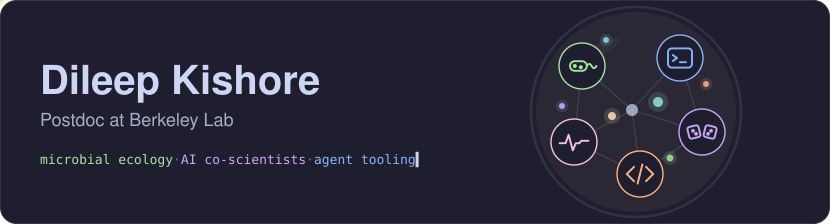

<picture>
  <source media="(prefers-color-scheme: dark)" srcset="assets/banner-dark.svg">
  <source media="(prefers-color-scheme: light)" srcset="assets/banner-light.svg">
  
</picture>

I'm a postdoc at Berkeley Lab, working on microbial ecology, AI co-scientists, and agent tooling.

### Research

- **[BERIL](https://beril-doe.org/) workbench**: a local web workbench for running BERIL research workflows with Claude Code and Codex.
- **Co-scientist bench**: benchmarks for AI co-scientist systems, scored from the evidence a finished research session leaves behind.
- **[beril-wiki](https://github.com/beril-doe/beril-wiki)**: a compiled wiki over BERIL's AI-conducted microbial biology research.
- **[trait-prediction](https://github.com/kbasecollaborations/trait-prediction)**: machine learning to predict carbon utilization traits, with its [manuscript](https://github.com/kbasecollaborations/trait-prediction-manuscript).

### Things I build

- **HealthFile**: privacy-first medical report extraction. It redacts personal data locally and pulls structured lab results out of medical PDFs.
- **BillLens**: turns pharmacy bills and receipts into structured purchase entries.
- **PII redaction models**: fine-tuning models to find and redact personal data in Indian legal and medical documents.
- **[zendots](https://github.com/dileep-kishore/zendots)**: my dotfiles and agent skills for macOS and Linux.
- **[bellwether](https://github.com/dileep-kishore/bellwether)**: a Herdr layout with agent status, chats, and Git changes.

Earlier: [MiCoNE](https://github.com/segrelab/MiCoNE) (microbial co-occurrence networks), [cayenne](https://github.com/quantumbrake/cayenne) (stochastic simulation), [nixos-config](https://github.com/dileep-kishore/nixos-config), [antibiotic-prediction](https://github.com/dileep-kishore/antibiotic-prediction).

[dileep-kishore.com](https://www.dileep-kishore.com/) · [@KishoreDileep](https://x.com/KishoreDileep) · [Google Scholar](https://scholar.google.com/citations?hl=en&user=QGD-dQEAAAAJ)
